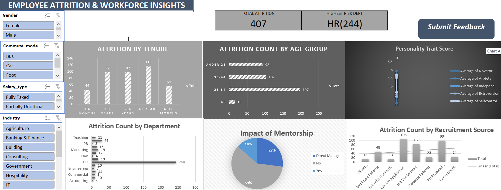

# 📊 Employee Turnover Analysis & Executive Dashboard

An interactive HR Analytics Excel dashboard built to analyze workforce attrition patterns, evaluate the impact of mentorship and recruitment channels, and deliver data-driven retention recommendations.

---

## 📸 Dashboard Overview

> **Interactive Features:** Connected multi-slicer filtering (`Gender`, `Commute Mode`, `Salary Type`, `Industry`) updating KPI summary cards and 6 pivot charts in real time. Built-in feedback mechanism via an embedded form button.

---

## 🎯 Business Problem & Objectives

High employee turnover increases recruitment costs and disrupts organizational productivity. The goal of this analysis was to identify core drivers of attrition across demographic, professional, and psychological factors to help HR leaders implement targeted retention strategies.

### Key Questions Answered:
1. Which tenure brackets experience the highest exit rates?
2. How does attrition vary across age demographics?
3. Which departments suffer from disproportionate turnover?
4. What is the impact of mentorship (`Has_coach`) on retention?
5. How effective are different recruitment sources?
6. Are there notable personality trait differences (`Novator`, `Anxiety`, `Extraversion`, etc.) between employees who stayed vs. left?

---

## 🛠️ Data Pipeline & Methodology

1. **Data Cleaning & Pre-processing (Power Query / Excel):**
   * Standardized binary event tracking (`1 = Left`, `0 = Stayed`).
   * Engineered `Experience_Group` (tenure brackets) and `Age_Group` (demographic tiers).
   * Verified data types and handled null/missing values.

2. **Exploratory Analysis (PivotTables):**
   * Constructed aggregated PivotTables to evaluate attrition across categories and average psychological trait scores.

3. **Dashboard Design & Architecture:**
   * Structured a clean grid layout with top KPI summary cards (`Total Attrition: 407`, `Highest Risk Dept: HR (244)`).
   * Integrated interactive left-sidebar slicers using **Report Connections** to sync all PivotCharts simultaneously.
   * Added a published **"💬 Submit Feedback"** button linked to a user feedback form.

---

## 📊 Key Insights & Findings

* **🚨 Critical Department Risk:** The **HR Department** exhibits severe turnover, accounting for **244 out of 407 leavers** (over 59% of total attrition).
* **👥 Demographic Vulnerability:** Employees aged **25–34** constitute the largest attrition cohort (**197 leavers**), followed by those aged **35–44** (**102 leavers**).
* **⏱️ Tenure Drop-off:** Attrition peaks between **1 to 4 years of service** (194 combined leavers), indicating mid-career burnout or career progression gaps.
* **🤝 Mentorship Impact:** Employees **without a coach** comprise the vast majority of resignations (**242 leavers**), demonstrating that structured coaching strongly boosts retention.

---

## 💡 Strategic HR Recommendations

1. **Conduct an HR Department Audit:** Investigate workload distribution, management culture, and competitive compensation specifically within the HR department to address the root cause of its 244 departures.
2. **Expand Mentorship Programs:** Scale up manager-as-coach or peer-mentorship initiatives, focusing particularly on new hires and mid-tenure employees (1–4 years).
3. **Target Early/Mid-Career Engagement:** Develop targeted career pathway frameworks for early-career staff (ages 25–34) to improve retention past the 1-year mark.

---

## 📁 Repository Structure
